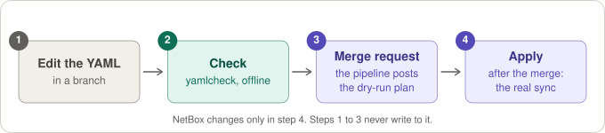
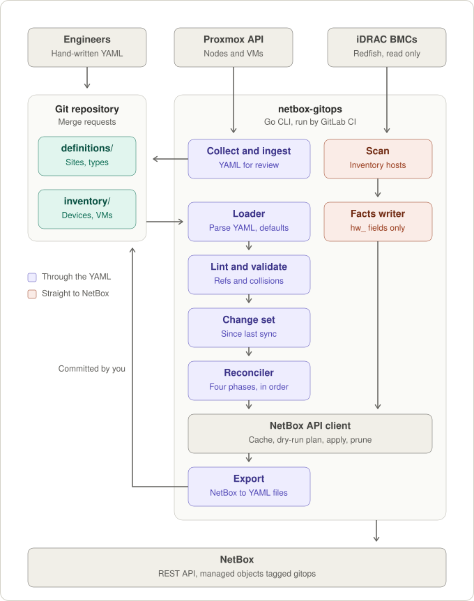

<div align="center">

# NetBox GitOps Controller

Describe your data center in YAML and review each change in a merge request.<br>
A pipeline job applies it to NetBox, so nobody has to click through the NetBox UI.

[](https://github.com/braunma/netbox-gitops-controller/actions/workflows/ci.yml)


[](LICENSE)

[Quickstart](#quickstart) ·
[Features](#key-features) ·
[Add a server](docs/WRITING_YAML.md#adding-a-server-end-to-end) ·
[Configuration](docs/CONFIGURATION.md) ·
[Examples](EXAMPLES.md) ·
[Roadmap](docs/ROADMAP.md)

</div>



This Go tool manages a NetBox instance declaratively (Infrastructure as Code).
The YAML in this repository is the desired state, and the controller applies
only the difference between it and what NetBox holds.

This YAML declares a server in a rack, cabled to a switch:

```yaml
# inventory/hardware/active/servers.yaml
defaults:
  device_type: "example-server-r100"
  role: "server"
  site: "berlin-dc"
  rack: "rack-a01"

devices:
  - name: "example-server-01"
    position: 10
    interfaces:
      - name: "eth1"
        link: { peer_device: "example-switch-01", peer_port: "GigabitEthernet1/0/1" }
```

A run with `--dry-run` prints the plan and writes nothing:

```text
✓   ✓ Creating devices: name=example-server-01
[DRY-RUN] POST: /api/dcim/devices/
…
⚠ DRY RUN COMPLETE: No changes applied
```

After the merge, the pipeline's apply job runs the same sync without
`--dry-run`. In the bundled GitLab pipeline someone starts that job by hand.
The interfaces come from the device type, and the controller wires the cable on
both ends from that one `link`.

## How it fits together



<details>
<summary>How to read this picture</summary>

Everything inside the `netbox-gitops` box is a command of this tool; the grey
boxes are the systems it talks to. Purple is the route through the YAML:
`collect` and `ingest` write YAML for a merge request, the sync reconciles the
repository into NetBox, and `export` writes existing NetBox objects out as YAML
files for you to commit. Coral is the one route that does not pass through the
YAML: `scan` reads the BMCs of the servers the inventory declares and writes
their hardware facts to NetBox as `hw_` custom fields.

</details>

## Quickstart

```bash
# 1. Build (Go 1.24.7+; dependencies download themselves)
make build

# 2. Point it at your NetBox
cp .env.example .env
$EDITOR .env                      # NETBOX_URL and NETBOX_TOKEN

# 3. See what it would do — against the bundled example data, so nothing of
#    yours is touched. --dry-run never writes.
./netbox-gitops --dry-run --data-dir example
```

That prints a plan and closes with a summary line like
`Plan: 43 to create, 0 to update, 0 to delete, 3 unchanged` (the numbers depend
on what your NetBox already holds). Nothing has been
written; drop `--dry-run` to apply.

Then, to change something real:

```bash
# 4. Edit the inventory. Start from the parked skeleton:
#    inventory/hardware/active/_new-server.yaml
$EDITOR inventory/hardware/active/servers.yaml

# 5. Check it without touching NetBox — syntax, models, and the cross-object
#    checks (duplicate IPs, rack collisions, cables, unknown slugs).
#    `make check` runs these plus the Go lint and unit tests.
go run ./cmd/yamlcheck definitions inventory

# 6. Read the plan for your own data before opening the merge request
./netbox-gitops --dry-run
```

### Where to look next

| If you want to… | Read |
|---|---|
| add a server, switch or storage system | [Adding a server, end to end](docs/WRITING_YAML.md#adding-a-server-end-to-end) |
| know what the checks catch before you push | [Checking the YAML before it reaches NetBox](docs/CHECKS.md#checking-the-yaml-before-it-reaches-netbox) |
| find out whether *your* NetBox accepts a value | [Checking against the live NetBox](docs/CHECKS.md#checking-against-the-live-netbox) |
| add hardware the repository has never seen | [Step 1: Define a Device Type](docs/WRITING_YAML.md#step-1-define-a-device-type-if-new) — or vendor one from the community library |
| fix a typo in a name or slug | [Renaming an Object](docs/CONCEPTS.md#renaming-an-object-fixing-a-typo) — do **not** just edit it |
| understand why a change did nothing | [Common Errors](docs/CONCEPTS.md#common-errors) and [Phase Order](docs/CONCEPTS.md#phase-order-dependency-model) |
| remove something | [Pruning Orphans](docs/USAGE.md#pruning-orphans) — pruning is opt-in |
| see every flag, variable or CI setting | [`docs/CONFIGURATION.md`](docs/CONFIGURATION.md) — a table for every command, variable and CI setting |
| bring a NetBox that was filled by hand under GitOps | [Adopting what NetBox already holds](docs/ADOPTING.md) — `netbox-gitops export` |
| document machines that already exist, without typing them in | [`docs/INGEST.md`](docs/INGEST.md) — sources → YAML → MR → NetBox |
| know what is planned but not built | [`docs/ROADMAP.md`](docs/ROADMAP.md) |

## Key Features

| Feature | What it does |
|---|---|
| **Idempotent** | Only differences are applied. A repeated run reads NetBox and writes nothing when the state is already correct. |
| **Change-based by default** | In a git checkout, a sync reconciles only what changed in the YAML since the last synced commit; `--full` reconciles everything. [Details](docs/USAGE.md#what-a-sync-looks-at) |
| **Safe next to manual work** | Everything the tool creates gets a `gitops` tag, and `--prune` deletes only tagged objects. One exception: a cable that blocks a declared connection is replaced, tagged or not. [Details](docs/USAGE.md#pruning-orphans) |
| **Auto-wiring** | Cables and LAG members are configured from the YAML, with each cable declared on one end. [Details](docs/WRITING_YAML.md#cabling-through-patch-panels) |
| **Renames in place** | `rename_from` renames an existing object when you correct its name, slug or other identifying field. [Details](docs/CONCEPTS.md#renaming-an-object-fixing-a-typo) |
| **Coverage** | DCIM, IPAM, platforms and tenants, custom fields, and virtualization (clusters, VMs and their interfaces). |
| **Type libraries** | Reads the community `devicetype-library` layout alongside the native format; local definitions win. [Details](docs/WRITING_YAML.md#reusing-the-community-device-type-library) |
| **Fact ingestion** | `collect` and `ingest` write discovered facts (Proxmox guests, iDRAC inventory) into the YAML for review in a merge request. [Details](docs/INGEST.md) |
| **Hardware scan** | `scan` reads the iDRACs of the declared servers over Redfish and writes their hardware facts to NetBox as `hw_` custom fields. [Details](docs/INGEST.md#hardware-facts-straight-to-netbox-scan) |
| **Type safety** | All input is validated against typed Go models before the API is called. [Details](docs/CHECKS.md#checking-the-yaml-before-it-reaches-netbox) |

## Documentation

| Guide | What it covers |
|---|---|
| [Writing the YAML](docs/WRITING_YAML.md) | Device types, devices, switch ports, cabling through patch panels, defaults and conventions |
| [Checking the YAML](docs/CHECKS.md) | Editor schemas, the offline checks, the merge request report, validation against a live NetBox |
| [Running the controller](docs/USAGE.md) | Dry run, apply, change-based and full sync, drift detection, JSON plan, selective sync, pruning |
| [Concepts and troubleshooting](docs/CONCEPTS.md) | Renaming, parking files, phase order, the `gitops` tag, tenants, tags, common errors |
| [Adopting an existing NetBox](docs/ADOPTING.md) | `export`: bring objects that were created by hand under GitOps |
| [Fact ingestion](docs/INGEST.md) | `collect`, `ingest` and `scan`: document machines that already exist |
| [Configuration reference](docs/CONFIGURATION.md) | Every flag, environment variable and CI setting |
| [CI/CD](CI_CD.md) | The GitLab pipeline: validate, plan, apply, schedules |
| [Examples](EXAMPLES.md) | The bundled example dataset, file by file |
| [Roadmap](docs/ROADMAP.md) | What is planned but not built |

## Discovering what already exists

The sync runs one way: you write YAML and the controller applies it. A few more
commands cover machines that were racked before anyone wrote a line of YAML,
and the facts nobody wants to type.

```bash
./netbox-gitops collect --dry-run     # Proxmox guests -> YAML changes for a merge request
./netbox-gitops scan --dry-run        # iDRAC hardware facts -> hw_ custom fields in NetBox
./netbox-gitops export --dry-run      # objects NetBox already holds -> YAML files
```

`collect` and `ingest` never write to NetBox: what they find becomes a YAML
change that someone reviews. `scan` is the one exception. It writes hardware
facts (CPUs, memory, drives, firmware, power draw) straight to NetBox as `hw_`
custom fields, and never touches `serial`, `asset_tag` or anything else the
YAML declares. See [Fact ingestion](docs/INGEST.md) and
[Adopting an existing NetBox](docs/ADOPTING.md).

## Project structure

```text
.
├── definitions/     # Sites, roles, device types, VLANs, prefixes, tenants, ...
├── inventory/
│   ├── hardware/    # active/ (servers, switches) and passive/ (patch panels, PDUs)
│   ├── virtual/     # Virtual machines
│   └── discovered/  # Written by collect/ingest, reviewed in a merge request
├── example/         # Public example data with the same layout
├── schema/          # JSON Schemas for editors, generated from the Go models
├── docs/            # The guides listed above
├── cmd/             # netbox-gitops (the controller), yamlcheck, schemagen
├── pkg/             # Loader, models, lint, reconciler, client, collectors, export
├── internal/        # Constants and the .env reader
└── tests/e2e/       # End-to-end suites that run against a throwaway NetBox
```

This repository separates your own data from the public examples:

- **`definitions/` and `inventory/hardware/`** are listed in `.gitignore`, so git
  does not pick up new files there unless you add them with `git add -f`. This
  repository force-adds a small sample set, including the `_new-server.yaml`
  skeleton.
- **`inventory/virtual/` and `inventory/discovered/`** are not ignored: VM
  definitions and ingested facts are meant to be committed.
- **`example/`** is committed data for the documentation, the Quickstart and
  some tests.

The controller reads `definitions/` and `inventory/` in the current directory
(`--data-dir` changes that). If there is no `definitions/` and no `--data-dir`
was given, it falls back to `example/` and says so.

## Example data

The `example/` directory ships a small, self-contained dataset used by some
tests and as a format reference. It covers two sites (Berlin DC, Test Lab) and a
few objects of each supported type:

- 2 sites, 5 device roles, 2 platforms, 1 tenant (+ group)
- 2 VRFs, 2 VLAN groups, 3 VLANs, 3 prefixes, 3 racks
- 6 device types (native format) + 1 in the community library format,
  2 module types + 2 in the library format, 22 custom fields (2 for VMs:
  `vmid`, `vm_template_id`; 20 `hw_*` hardware facts)
- 8 hardware devices — including a blade chassis with two child blades, a GPU
  server, and a patch panel (front/rear ports)
- 2 virtual machines (one clustered, one site-only)

See **[EXAMPLES.md](./EXAMPLES.md)** for the full breakdown, file layout, and the
key concepts each file demonstrates.

## License

Licensed under the [Apache License, Version 2.0](./LICENSE). Every source file
carries an `SPDX-License-Identifier: Apache-2.0` line.
