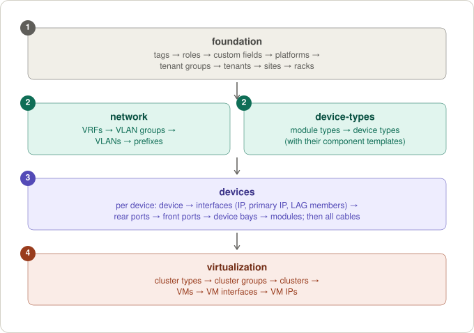

# Concepts and troubleshooting

How the controller behaves in the cases that surprise people, and what its error messages mean.

## Renaming an Object (Fixing a Typo)

Every object is matched against NetBox by an **identifying field**. That is what
makes the sync idempotent — and it is also why editing that field is not an
ordinary change. The old value stops matching anything, so the object is created
a *second* time and the original is left behind, still holding every reference
that pointed at it. Nothing errors; you just quietly end up with two.

Declare where the object came from and it is renamed in place instead:

```yaml
- name: Rack 01          # was "Rakc 01"
  slug: rack-01
  site: frankfurt
  rename_from: Rakc 01   # ← the previous identity
```

Once the sync has run, NetBox holds the new value, the declaration becomes a
no-op, and you can delete the line. Leaving it in place is harmless.

**Which field is the identity?** It differs per object type, because NetBox
does. `rename_from` always holds the previous value of *that* field:

| Object | Identified by | `rename_from` holds |
|---|---|---|
| Site, device role, platform, tenant, tenant group, tag, VLAN group, cluster type, cluster group, device type | `slug` | the old slug |
| Rack, device, interface, VM, VM interface, cluster, VRF, custom field | `name` | the old name |
| Module type | `model` | the old model |
| VLAN | `vid` | the old VID, quoted (`"201"`) |
| Prefix | `prefix` | the old CIDR |

Two consequences worth knowing:

  * For a slug-identified object, changing only the **name** needs no
    declaration — the slug still matches, so it is a plain update. The same goes
    for a VLAN's name, since a VLAN is identified by its VID.
  * A rename changes *what an object is called*, not where it lives. The scope
    (site, device, cluster) is carried over unchanged; moving an object between
    scopes is a different operation and is not what this does.

**Safety.** `rename_from` describes an object's past, which is weaker evidence
than a plain identity match — a typo in it can name a real object that has
nothing to do with your declaration. So:

  * Only objects carrying the `gitops` tag can be renamed (tags and custom
    fields cannot carry the tag, so they are renamed without this check). To bring an existing
    unmanaged object under management, declare it under the name it *already*
    has; the next sync adopts and tags it, and it can be renamed after that.
  * If `rename_from` matches more than one object, the sync fails rather than
    guessing.
  * If objects exist under **both** the old and the new identity, nothing is
    renamed and you get a warning — which one survives is your call, not the
    tool's.
  * A `rename_from` that matches nothing is not an error; that is simply what it
    looks like once it has been applied.

`--dry-run` reports a rename as the update it is, without writing.

## Parking a File (Ignored Files)

Not everything in the repository should be applied. Inventory owned by another
system, a draft you are not ready to sync, a reference copy — all of these can
stay in place and be skipped:

```bash
# Default: filenames starting with an underscore are skipped
inventory/hardware/active/_imported-from-cmdb.yaml   # not applied

# Override the patterns (globs, matched against the filename)
./netbox-gitops --ignore-file '_*.yaml' --ignore-file 'imported-*.yaml'
export IGNORED_FILES='_*.yaml,imported-*.yaml'

# Apply everything, including parked files
./netbox-gitops --include-ignored-files
```

Every skipped file is logged, so a parked file never goes unnoticed. Patterns
match the **filename only**, not the path — a file inside a directory whose
name matches a pattern is still loaded. An invalid glob fails at startup rather
than silently matching nothing.

> **Pruning:** A parked file is invisible to the controller, so `--prune`
> cannot tell its objects apart from orphans. Two cases, and only you can tell
> them apart:
>
> - Objects **another system owns** were never created here, carry no `gitops`
>   tag, and are safe — pruning touches no untagged object except a cable left
>   without terminations.
> - Objects **this controller previously created** from a file you have now
>   parked still carry the tag and **will be deleted** as orphans.
>
> A run that both skips files and uses `--prune` warns and lists the skipped
> files before deleting anything. Preview with `--dry-run --full --prune` first.

## Front Ports Across NetBox Releases

NetBox 4.5 replaced a front port's singular `rear_port` / `rear_port_position`
fields with a `rear_ports` list of `{position, rear_port, rear_port_position}`
mappings — and **accepts the old fields silently rather than rejecting them**,
so sending the wrong shape leaves the port created but unwired.

The controller picks the shape from the release reported by `/api/status/`, so
patch panels wire correctly on both older releases and 4.5+. Nothing in your
YAML changes; `rear_port` and `rear_port_position` stay as they are.

## NetBox Version Compatibility

On startup the controller reads `/api/status/`, logs the detected release, and
refuses to run against NetBox older than **3.6** — the release that renamed the
device `device_role` field to `role`. Without this check an unsupported server
produces a scatter of `400 Bad Request` errors on individual fields rather than
one clear message.

A server whose version cannot be determined (no status endpoint, a proxy that
rewrites it) is reported as a warning and the run continues: the check exists
to explain failures, not to become a new way to fail.

## Phase Order (Dependency Model)

NetBox rejects an object whose references do not exist yet — a device needs its
site, role and device type; a prefix needs its VRF. The controller therefore
reconciles in a fixed order derived from the object types themselves, **not**
from file or directory names. You never have to number or sort your YAML: the
file names and their order inside each kind's folder are free-form, and the
same order runs every time.



| # | Phase | Objects, in reconcile order |
|---|-------|-----------------------------|
| 1 | `foundation` | tags → roles → custom fields → platforms → tenant groups → tenants → sites → racks |
| 2 | `network` | VRFs → VLAN groups → VLANs → prefixes |
| 2 | `device-types` | module types → device types (each incl. its component templates); manufacturers are created on first use |
| 3 | `devices` | per device: device → interfaces (with IP address, primary IP, LAG members) → rear ports → front ports → device bays → modules; **then all cables** |
| 4 | `virtualization` | cluster types → cluster groups → clusters → VMs → VM interfaces → VM IPs |

Two orderings inside a phase are worth knowing about, because both solve
problems that a "number your files" convention leaves to the user:

  * **Cables run last, in a second pass.** A cable needs the ports on *both*
    ends to exist, so every `link:` found while reconciling devices is queued
    and applied only after all devices and their ports are in place. Peer order
    in the YAML is irrelevant.
  * **Parents are reconciled before their children.** A device with
    `parent_device` is installed into a bay on that parent, so the parent must
    exist first. The device list is topologically sorted before reconciliation,
    at any nesting depth — a blade may be declared above its chassis, or in an
    alphabetically earlier file, and the run still succeeds. A `parent_device`
    that is not declared in the run is assumed to exist in NetBox already; a
    cycle (`a` parented to `b` parented to `a`) is reported as an error before
    any device is reconciled (the earlier phases have already run).

The phase order is asserted by `TestValidPhasesCreationOrder`, and its mirror
image — the reverse order used for `--prune` — by
`TestPruneTargetsReverseDependencyOrder`.

## The `gitops` Tag

  * The controller automatically tags every taggable object it creates with `GitOps Managed` (slug: `gitops`). You never write `gitops` into a `tags:` list yourself.
  * **Default behavior:** If you remove a device from the YAML file, it is **not** deleted from NetBox — the tool only creates and updates objects unless you opt into pruning. One exception: a cable that occupies a port a declared `link:` needs is deleted to make room, tagged or not.
  * **A second tag, `gitops-state`,** is the controller's note to itself: its description holds the commit NetBox was last synced to, which is what a [change-based sync](USAGE.md#what-a-sync-looks-at) compares against. It is never attached to an object. Leave it alone; deleting it only makes the next sync a full one.
  * **Pruning (`--prune`):** Run a full sync with `--prune` (`--full --prune` in a git checkout) to delete orphans — objects that still carry the `gitops` tag but are no longer declared in YAML. Pruning deletes only managed objects, except cables left without terminations; tags themselves are never pruned. Combine with `--dry-run` to preview the deletions before applying them. Pruning is scoped to the phases that run (`--only`) and cannot be combined with `--site`/`--device`/`--vm`. See [Pruning Orphans](USAGE.md#pruning-orphans) for the full semantics.

## Tenants

A tenant (German NetBox UI: *Mandant*) is defined once and then assigned with
a `tenant:` field on anything that can belong to one — sites, racks, devices,
VRFs, VLANs, prefixes, clusters and VMs:

```yaml
# definitions/tenant_groups/tenant_groups.yaml — optional grouping
- name: "Internal"
  slug: "internal"

# definitions/tenants/tenants.yaml — define the tenant once
- name: "Platform Engineering"
  slug: "platform-engineering"
  group: "internal"

# definitions/sites/sites.yaml — reference it by slug (the name works too)
- name: "Berlin DC"
  slug: "berlin-dc"
  tenant: "platform-engineering"
  description: "Primary data center"
```

To give every object in a file the same tenant, put `tenant:` under the file's
`defaults:` block; an entry's own `tenant:` wins.

  * **Nothing is inherited.** A rack in a site with a tenant has no tenant
    unless it (or its file's `defaults:`) declares one, exactly as in NetBox.
  * **Leaving `tenant:` out leaves the tenant alone.** A tenant assigned in the
    NetBox UI survives a sync; removing the line from the YAML does not clear
    it in NetBox.
  * **An unknown tenant never fails the object.** `yamlcheck` reports it as
    `unknown-tenant` (and `validate` as `missing-reference` when NetBox does
    not hold it either); a sync creates the object without a tenant and warns.

## Your Own Tags

Most objects can carry tags of their own — sites, racks, VRFs, VLANs, VLAN groups,
prefixes, platforms, tenants and tenant groups, device and module types,
devices, their interfaces, modules, front/rear ports and IP addresses, cluster
types/groups, clusters, VMs and VM interfaces:

```yaml
# definitions/extras/tags.yaml — define the tag once
- name: "Production"
  slug: "production"
  color: "f44336"

# anywhere else — reference it by slug (the name works too)
- name: "berlin-srv-web-01"
  tags: ["production"]
  interfaces:
    - name: "eth0"
      tags: ["uplink"]
      ip:
        address: "10.10.20.101/24"
        tags: ["dmz"]
```

  * **The YAML is the full set.** An object ends up with exactly the tags it
    declares plus `gitops`. Removing a tag from the YAML removes it in NetBox,
    and a tag added by hand in the UI is replaced on the next sync — as it
    always was, since the managed tag alone was sent before.
  * **`defaults` combine.** A `tags:` list under `defaults` is merged with each
    object's own list rather than replaced by it.
  * **Lists under `defaults` are shared, ranges included.** A `modules:` list
    under `defaults` reaches every device in the file, and a name with a
    range (`GPU Slot {1-8}`) expands there as it does on a device. A device
    that lists the same key replaces the shared list; only `tags` combine.
  * **Undefined tags are left off, not fatal.** A tag that exists neither in
    `definitions/extras` nor in NetBox is skipped with a warning, and the
    object is synced without it. `yamlcheck` reports it beforehand as
    `unknown-tag`.

## Common Errors

The first four below are load errors. `yamlcheck` reports them, and
so does every sync before it sends a single request: the whole data directory
is read first, and any problem stops the run with nothing written. The two
after them come from `yamlcheck`'s cross-object checks only; a sync does not
stop on them.
Each problem is one line naming the file and the line the entry starts on,
the entry and the object:

```text
✗ inventory/hardware/active/servers.yaml:21: entry 1: device "srv-01": interfaces[1].ip: unknown field "vfr" (did you mean "vrf"?)
✗ inventory/hardware/active/servers.yaml:58: entry 3: device "srv-03": device_type is required
✗ 2 problem(s) in .; nothing was sent to NetBox. `yamlcheck` reports the same list.
```

**`… device "srv-01": interfaces[1].ip: unknown field "vfr" (did you mean "vrf"?)`**

  * **Cause:** a key the object does not have — usually a typo, sometimes a
    field from another object type. The path after the entry number says
    where; the hint appears when one spelling is clearly meant. Such a key
    used to be dropped without a word, so the object synced without it; it
    now stops the load.
  * **Fix:** correct the key. [Field names](WRITING_YAML.md#field-names) lists the reference
    keys per object type.

**`… device "srv-02": both "site" and "site_slug" are set; they are the same field, keep one`**

  * **Cause:** the short and the long spelling of one field in the same
    mapping. Across `defaults` and an entry they do not collide — the entry's
    value wins in either spelling.
  * **Fix:** delete one of the two lines.

**`….yaml: grouped form has "defaults" but no "items" list; the objects are under "device" (did you mean "items"?)`**

  * **Cause:** the list of a grouped file is under a misspelled key. The file
    would otherwise be read as a single object with the unknown fields
    `defaults` and `device`, which points away from the mistake.
  * **Fix:** name the list `items:` (`devices:` is also accepted).

**`….yaml: defaults.interfaces.idrca matches no interface listed in this file`**

  * **Cause:** per-interface defaults apply only to interfaces a device lists,
    by exact name. A name nobody lists is a typo or a leftover.
  * **Fix:** correct the name, list the interface on the devices that should
    get it (`- name: "idrac"` is enough), or delete the block.

**`API error 400: {"type": [...]}` on an interface**

  * **Cause:** an interface exists neither as a template on the device type nor
    with a `type` of its own.
  * **Fix:** name the template's interface, or give the interface a `type`.
    `yamlcheck` reports this as `untyped-interface`.

**Cables "flap" — deleted and recreated on every run**

  * **Cause:** two devices claim the same peer port. A port holds one cable.
  * **Fix:** check the `link:` declarations. `yamlcheck` reports this as
    `cable-conflict`.

**A device type change (e.g. a new port) does not appear on existing devices**

  * **Cause:** standard NetBox behaviour. Editing the blueprint does not
    retrofit instances that already exist.
  * **Fix:** use "Sync components" on the device type page in NetBox, or delete
    and re-sync the device. Global attributes like `u_height` do update
    immediately.
