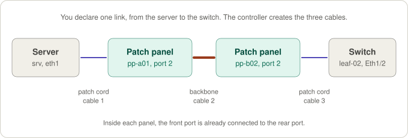

# Writing the YAML

How to describe hardware in this repository: device types, devices, switch ports and cabling, and the conventions that keep the files short. For the checks that catch mistakes, see [Checking the YAML](CHECKS.md).

## Step 1: Define a Device Type (if new)

File: `definitions/device_types/servers.yaml` (every `*.yaml` or `*.yml` under
`definitions/device_types/`, subdirectories included, is loaded, except parked
`_*.yaml` files)

Here we define the "blueprint" including all physical ports. NetBox copies these ports *once* when a device is instantiated.

```yaml
- model: "Dell PowerEdge R640"
  slug: "dell-r640"
  manufacturer: "Dell"
  u_height: 1
  is_full_depth: true
  interfaces:
    - name: "idrac"
      type: "1000base-t"
      mgmt_only: true
    - name: "eth0"
      type: "25gbase-x-sfp28"
  # Optional: console_ports, console_server_ports, power_ports, power_outlets,
  # front_ports/rear_ports for patch panels, module_bays, device_bays
```

Identical ports are written once, as a range. A template name holding
`{a-b}` stands for one template per number, and another ranged field of the
same entry counts along with it, which is how a panel's front ports map onto
its rear ports:

```yaml
  interfaces:
    - { name: "Management 1/1", type: "1000base-t", mgmt_only: true }
    - { name: "Eth1/{1-48}", type: "25gbase-x-sfp28" }
    - { name: "Eth1/{49-54}", type: "100gbase-x-qsfp28" }
  front_ports:
    - { name: "{1-48}", type: "lc", rear_port: "{1-48}" }
  rear_ports:
    - { name: "{1-48}", type: "lc" }
```

Quote a name that starts with the range: unquoted, `{1-48}` is YAML's
flow-mapping syntax. A leading zero sets the width (`{01-12}` gives
`01`…`12`). Two ranges that do not span the same count, a range that runs
backwards, or a range in `rear_port` without one in `name` are errors naming
the entry. The expansion happens when the file is read, so every check and
NetBox see the individual ports. The same works on a device's own
`interfaces`, `modules` and ports.

### Reusing the community device type library

You do not have to hand-write a device type that already exists. The NetBox
community publishes thousands of them in the
[devicetype-library](https://github.com/netbox-community/devicetype-library),
and that format is consumed **unchanged** — one device type per file, laid out
as `<library>/<Manufacturer>/<model>.yaml`, with hyphenated component keys
(`console-ports`, `power-ports`, …).

Point the controller at a library checkout:

```bash
# Explicit path (a git submodule, a clone, or a directory of vendored files)
./netbox-gitops --devicetype-library ../devicetype-library/device-types

# Or via the environment
export DEVICETYPE_LIBRARY=../devicetype-library/device-types
```

With neither set, `definitions/device_type_library/` inside the data directory
is used if it exists — so vendoring just the models you need is as simple as
copying the files in:

```text
definitions/
├── device_types/              # Native format: a YAML list per file
│   └── servers.yaml
└── device_type_library/       # Community format: one device type per file
    └── Dell/
        └── poweredge-r650.yaml
```

Library entries are merged with your native definitions. If both define the
same slug, **your local definition wins** and the override is logged, so a
vendored library can be customised without editing the checkout. Inventory
items, which this project does not manage, are reported rather than dropped
silently. A few other library-only fields (an interface's `bridge`, the image
and `is_powered` flags, a module type's `profile` and `attribute_data`) are
accepted and ignored.

See `example/definitions/device_type_library/` for a working example.

### Module types from the same library

The library ships a `module-types/` tree alongside `device-types/`, covering
the hardware that goes *into* module bays — line cards, NIC mezzanines,
transceivers, power supplies. It is consumed the same way:

```bash
./netbox-gitops --moduletype-library ../devicetype-library/module-types
export MODULETYPE_LIBRARY=../devicetype-library/module-types
```

With neither set, `definitions/module_type_library/` inside the data directory
is used if it exists. A module type carries the same component templates as a
device type (interfaces, console and power ports, front/rear ports, module
bays — everything except device bays, which NetBox allows only on a device
type).

Component names in this library commonly contain the literal `{module}`
placeholder:

```yaml
interfaces:
  - name: '{module}-1GbE-0'
    label: '1'
    type: 1000base-t
```

NetBox substitutes it with the module bay position when the module is
installed, so the same module type in two bays produces `1-1GbE-0` and
`2-1GbE-0` rather than colliding. The placeholder is passed through verbatim.

> **Note:** NetBox requires a module type's manufacturer and model to be
> unique together, and module types have no slug. Two library files claiming
> the same pair cannot both be applied; the loader reports every such conflict
> at once so you can park the unwanted file with `--ignore-file` (the flag
> replaces the default patterns, so repeat `_*.yaml,_*.yml` alongside it). The published
> library currently contains one (two Panduit part numbers sharing a model
> name).

### Referring to a module type

A device installs a module by naming its bay and the module type:

```yaml
modules:
  - name: OCP-1                       # the module bay on the device
    module_type: dell-ocp-25g
```

(`module_type_slug:` is accepted as well; see [Field names](#field-names).)
The slug is a local reference key, not something NetBox stores:

  * A module type defined **natively** uses the `slug` you gave it. The slug is
    optional; without one, refer to the type by its model name, which is
    accepted as a key too.
  * A module type read from a **library** has no slug in the file, so the key
    is derived from its model — `Dell OCP 25GbE Mezz` becomes
    `dell-ocp-25gbe-mezz`.

Different vendors may legitimately ship the same model name. When that happens
the bare name is ambiguous and is **not** accepted; use the
manufacturer-qualified form, which always works:

```yaml
    module_type: dell/sfp-10g-sr
```

`yamlcheck` rejects the bare name as an unknown module type and lists the keys
that exist. A sync warns `Module type <name> not found, skipping` and leaves
that module out; when both colliding types are reconciled in the same run it
also lists the qualified keys to use.

## Step 2: Create Device Instances (Server/Switch)

File: `inventory/hardware/active/servers.yaml`

Inventory files support a grouped form: fields under `defaults` are merged
into every device in the file (device values win, `tags` are combined). The
same form works for every definition kind too — racks, VLANs, prefixes and so
on — with the list under `items:` instead of `devices:` (either key is
accepted in any file, but not both at once).
Since the ports already come from the device type template, an interface is
only listed here when it carries device-specific data — IPs, VLANs, cabling —
without repeating `type` or `enabled`.

```yaml
defaults:
  site: "berlin"
  role: "server"
  device_type: "dell-r640"
  rack: "rack-a01"
  tags: ["production"]
  interfaces:                    # per interface name, see below
    idrac:
      description: "Dell iDRAC"
      ip: { vrf: "Management" }
    eth0:
      ip: { vrf: "Production" }
      address_role: "primary"    # sets the primary IP on the device

devices:
  - name: "srv-web-01"
    position: 10
    interfaces:
      - name: "idrac"
        ip: "10.0.10.50/24"      # string shorthand for `ip: { address: ... }`
      - name: "eth0"
        ip: "10.0.20.50/24"
        link: { peer_device: "sw-leaf-01", peer_port: "Eth1/1", cable_type: "cat6a" }

  - name: "srv-web-02"
    position: 12
    interfaces:
      - name: "idrac"
        ip: "10.0.10.51/24"
```

The classic form — a plain YAML list of devices — is still fully supported;
`defaults` is just a shortcut, and every field can still be set per device.

### Interface defaults

Under `defaults`, `interfaces` is a mapping from an interface **name** to the
fields every interface of that name gets. It works in device and VM files.

  * It applies to interfaces a device **lists**. A device that should get the
    defaults lists the interface, if only by name (`- name: "eth1"`). The one
    exception is explicit: an entry with `always: true` is added to every
    device in the file that does not list it, for a port whose whole
    configuration is shared (a PXE port and its VLAN). Use it only in a file
    whose devices all have that port.
  * The device's own values win. Nested mappings — `ip`, `link` — are merged
    key by key, so a default `ip: { vrf: ... }` combines with the device's
    `ip: "10.0.0.5/24"` shorthand. `tags` are combined.
  * An `ip` default is for the interfaces that have an address and a `link`
    default for those that are cabled: an interface listed by name alone gets
    neither block, only the other fields.
  * A name under `defaults.interfaces` that no device in the file lists is an
    error (it is a typo or a leftover), and so is a field the interface does
    not have.

### Interfaces as a mapping

`interfaces:` may also be written as a mapping keyed by interface name, the
way `defaults.interfaces` is: an address alone, a mapping of fields, or
nothing to list the interface for its defaults. A server that is its name,
its position and two addresses then fits in three lines:

```yaml
  - name: "srv-web-03"
    position: 14
    interfaces: { idrac: "10.10.10.103/24", eth0: "10.10.20.103/24" }
```

The interfaces are sorted by name, since a YAML mapping keeps no order. The
list form is unchanged; one object uses one or the other.

### Field names

References to other objects use the short name of the object they point at.
The longer spelling the repository used before is still accepted; writing
both forms of one field in the same mapping is an error.

| Object | Short name | Also accepted |
|---|---|---|
| device | `site`, `role`, `device_type`, `rack` | `site_slug`, `role_slug`, `device_type_slug`, `rack_slug` |
| device module | `module_type` | `module_type_slug` |
| rack, VLAN group | `site` | `site_slug` |
| VLAN | `site`, `group` | `site_slug`, `group_slug` |
| prefix | `site`, `vrf`, `vlan` | `site_slug`, `vrf_name`, `vlan_name` |
| tenant | `group` | `group_slug` |
| tenant group | `parent` | `parent_slug` |
| cluster | `site`, `type`, `group` | `site_slug`, `type_slug`, `group_slug` |
| VM | `site`, `role` | `site_slug`, `role_slug` |

Most "is not declared" errors list what is declared — the racks at that
site, the VLANs at that site, the device type's template ports — and a
collision names the way out: `rack-collision` lists the free units of the
rack, `duplicate-ip` the next free address in the prefix.

Every key is checked against the object it belongs to, nested ones (an
interface's `ip`, a module) included. A misspelled field — `vfr:` for `vrf:`,
`rack_name:` for `rack:` — fails the load with the file, the entry and the
path to the key, and a suggestion where one is obvious, instead of being
dropped without a word as it was before. `custom_fields` is free-form and not
checked.

## Step 3: Configure Switch Ports & VLANs

File: `inventory/hardware/active/switches.yaml`

```yaml
- name: "sw-leaf-01"
  # ... (Header params like site, role...) ...
  interfaces:
    - name: "Eth1/1"
      mode: "access"
      untagged_vlan: "Server-Vlan"
      # OR for Trunks:
      # mode: "tagged"
      # tagged_vlans: ["Vlan10", "Vlan20"]
```

## Cabling through patch panels

A strand between two racks is three cables and two panel-internal bridges:



```text
srv[eth1] -- pp-a01[front 2 > rear 2] ==== pp-b02[rear 2 > front 2] -- leaf-02[Eth1/2]
   patch cord          backbone (rear to rear)           patch cord
```

The bridges are in the panel's device type (front port 2 maps to rear port 2).
The three cables are written once, on the endpoint, as the path they form:

```yaml
- name: "eth1"
  link: { via: ["pp-a01:2", "pp-b02:2"], peer_device: "leaf-02", peer_port: "Eth1/2" }
```

`via` names the panels by the front port the cord lands on, in order from
this port to the peer.

The loader derives the cables from it when the data is read. `yamlcheck`,
`validate` and a sync run with `--verbose` print each path as NetBox will hold
it:

```text
Cable path: srv[eth1] > pp-a01[front 2] > pp-a01[rear 2] > pp-b02[rear 2] > pp-b02[front 2] > leaf-02[Eth1/2]
```

  * **The panel says what its cables are.** `cable_defaults` on a patch panel
    (or in its file's `defaults:`) gives the type and colour of the cords into
    its front ports and the backbones out of its rear ports (on a one-panel
    path the rear cable is a cord and takes `front`), so a path carries only
    where it goes:

    ```yaml
    cable_defaults:
      front: { cable_type: "smf-os2", color: "yellow" }
      rear: { cable_type: "smf-os2", color: "purple" }
    ```

    A path overrides them where it differs. `cable_type`, `color` and
    `length` on the link describe its **patch cords** (both ends); the
    backbone between the panels is the panels' own and keeps their `rear`
    defaults. A hop written as a mapping sets the cable **leaving** that
    panel toward the peer, backbone included:
    `{ device: "pp-a01", port: "3", color: "green" }` makes that backbone
    green. Precedence: hop, then link (cords only), then the panel's
    defaults. They apply only to the cables a path produces; a cable declared
    on its own with a `link:` is exactly what it says, since it may be a
    different cable.
  * A path runs through one panel (cord in on the front, the rear port wired
    on to the peer) or two. A longer run would need a front-to-front cord
    between two panels, which the reconciler wires as a backbone, so it is
    refused; declare such a run as separate cables on the panels' ports.
  * Every panel on the path must be declared here with role `patch-panel`,
    and its device type (or the panel itself) must map the named front port
    to a rear port. Anything else is an error that quotes the path as written.
  * A rear port the panel already declares is reused: with no link it gets the
    backbone, with a link to the same far end and the same cable it is left
    alone (two strands on one trunk), with a link elsewhere or a different
    type, colour or length it is an error quoting both.
  * The explicit form — one `link:` per cable, the backbone on the panel's
    `rear_ports` — keeps working and is what `via` expands to. Mixing both for
    the same strand is allowed only where they agree; a disagreement is an
    error rather than one of them winning quietly.
  * The far end should be declared in this repository. A peer that exists only
    in NetBox is wired by its NetBox role at apply time, which `yamlcheck`
    cannot see (`undeclared-peer-device`).

`tests/e2e/repo-data.sh` asks NetBox to trace both sample strands end to end,
so the shape above is exercised against a real NetBox on every e2e run.

## What the controller fills in

A value the YAML leaves out and another declared object determines is filled
in when the data is loaded, and said out loud, one line per value (`Derived:
device srv-01 interface idrac: vrf "Management" (from prefix
10.0.10.0/24)`).
`validate` and `yamlcheck` print every line; a change-based sync or plan
prints the lines of the objects it picked; a full sync prints them only with
`--verbose`. The last three rows of the table are fixed defaults applied when
the object is written; they print no line. A value written in the YAML is never changed. The rules:

| Left out | Filled from | Rule |
|---|---|---|
| a device's `site` | its `rack`, or its `parent_device` | a rack is at one site; a child sits where its chassis sits |
| a device's `face` | its `position` | a positioned device is front-mounted unless it says `rear` |
| an address's `vrf` | the prefix it falls into | the most specific declared prefix containing the address, when that prefix is in a VRF |
| a prefix's `site` | its `vlan` | when that VLAN is declared at exactly one site |
| a VLAN's `group` | its site | when the site has exactly one VLAN group |
| `status` on sites, racks, VLANs, prefixes, devices, modules | — | `active` |
| the `gitops` tag | — | on every taggable object |

A device with neither `site`, `rack` nor `parent_device` is an error naming
all three. Not derived, on purpose: an interface's VLAN. A port's layer 2
(access, trunk, routed) is not implied by its address, and a wrong guess
there changes what the switch is told. With these rules a server in an existing rack is its name, its
position, its serial and asset tag, and its addresses.

## Conventions that keep the YAML small

  * **Ports live in the device type, not the inventory.** Define every
    physical port once as an interface template (Step 1). In the inventory,
    only list an interface when it needs device-specific settings, and never
    repeat its `type` — `type` on a concrete device is only needed for
    interfaces that do *not* exist in the template (e.g. virtual or LAG
    interfaces).
  * **Interfaces are enabled by default.** `enabled: true` is implied; only
    write `enabled: false` to shut a port.
  * **One interface carries `address_role: primary`.** NetBox stores a single
    `primary_ip4` and a single `primary_ip6` per device, so exactly one
    interface may claim it per address family — usually the in-band management
    NIC, not the BMC/iDRAC (an out-of-band address is documented by leaving the
    role off). The role may sit on the interface or inside its `ip:` mapping;
    both spellings mean the same thing. Two interfaces claiming it is
    `duplicate-primary-ip`, since NetBox would keep whichever one was written
    last.
  * **Declare each cable on one end only.** Pick a convention (e.g. the
    server/endpoint side owns the `link:`) — the reconciler wires both ends
    from a single declaration. Declaring the same cable from both sides works
    but means every re-patch is a two-file edit.
  * **Write a run through patch panels as one path.** A strand from a server
    through the panel in its rack, the backbone, and the panel in the far rack
    to a switch is three cables; `link.via` declares it once, at the endpoint
    (see [Cabling through patch panels](#cabling-through-patch-panels)).
  * **Group shared fields in `defaults`.** One file per rack, role or
    hardware batch with a `defaults` block keeps each device down to its name,
    position and IPs. Definitions take the same block with an `items:` list,
    e.g. `defaults: { site: "berlin-dc", u_height: 42 }` for a site's
    racks.
  * **Put what every BMC or uplink shares in `defaults.interfaces`.** The
    description, VRF, status and `address_role` of `idrac` or `eth0` are the
    same on every server of a batch; written once under the interface's name,
    each device keeps only its addresses and its cable. See
    [Interface defaults](#interface-defaults).
  * **Use the short field names.** `site`, `role`, `device_type`, `rack` and
    the others in [Field names](#field-names) are what the bundled files use;
    the `*_slug` spellings still load but read worse.
  * **`face` defaults to `front`.** NetBox requires a face with every rack
    position. A device that declares `position` but no `face` is sent as
    front-mounted; write `face: "rear"` for the exceptions. It is one of the
    values the controller fills in (see
    [What the controller fills in](#what-the-controller-fills-in)); the rule is
    in the model (`EffectiveFace`).
  * **Leave out what is already the default.** `tags: ["gitops"]` is never
    needed — the managed tag is stamped on every taggable object automatically — and
    `status: "active"` is what sites, racks, VLANs, prefixes, devices and
    modules get when `status` is omitted. Write `status` only when it is
    something else.
  * **Start from the parked template.** `inventory/hardware/active/_new-server.yaml`
    holds a filled-in skeleton. The leading underscore parks it, so it is never
    applied (see *Parking a File* below) — copy a block out of it rather than
    editing it.

## Adding a server, end to end

With those conventions in place, a new machine in an existing rack is its
identity and its addresses, and nothing else:

```yaml
# inventory/hardware/active/servers.yaml — `defaults` supplies site and role,
# and `defaults.interfaces` the description, VRF and status of idrac and
# eth0 and eth0's primary-IP role
  - name: "berlin-srv-web-03"
    device_type: "poweredge-r740"
    rack: "berlin-rack-a01"
    position: 14
    serial: "WEB03-SN-KLMNO"
    tags: ["production"]

    interfaces:
      - name: "idrac"
        ip: { address: "10.10.10.103/24", dns_name: "berlin-srv-web-03-idrac.example.com" }
      - name: "eth0"
        ip: { address: "10.10.20.103/24", dns_name: "berlin-srv-web-03.example.com" }
        link: { peer_device: "berlin-leaf-01", peer_port: "Eth1/4", cable_type: "dac-active" }
```

Then check it before it reaches NetBox:

```bash
go run ./cmd/yamlcheck definitions inventory
```

Nothing else has to change — the switch side is wired from the server's
`link:`, and the ports come from the device type. The switch is edited only
when the new port needs a VLAN it does not already have.
